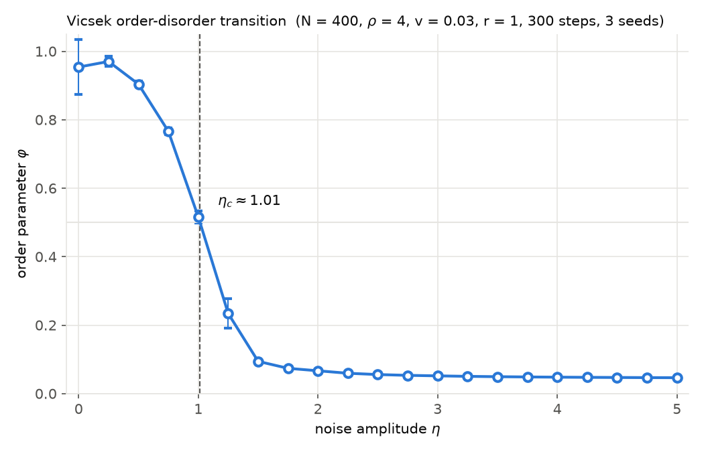

# PyVicsek

[](https://github.com/mehtan-rahman/PyVicsek/actions/workflows/ci.yml)
[](https://codecov.io/gh/mehtan-rahman/PyVicsek)
[](https://pypi.org/project/pyvicsek/)

A small Python library for simulating the [Vicsek model](https://doi.org/10.1103/PhysRevLett.75.1226) of collective motion: self-propelled particles that align with the mean heading of their neighbours within a radius, subject to noise.

What it does:

- Periodic boundary conditions (default, `use_pbc=True`). With `use_pbc=False` the box is open: particles are not wrapped, and a particle that leaves `[0, L)` is simply excluded from neighbour searches. There are no reflecting walls.
- Any number of spatial dimensions (the examples below are 2-D and 3-D; animation is 2-D only).
- Heterogeneous particle types with per-pair alignment and noise weights (`HeterogeneousVicsek`).
- A cell list for neighbour finding, an order-parameter time series, an equilibration check, and a noise sweep (`simulate_phase_transition`).

Noise is applied as a random vector of length `noise_factor` added to the unit mean direction, then renormalised (vectorial noise), not as the uniform angular noise of the 1995 paper. Particles are updated sequentially within a step.

## Installation

```
pip install pyvicsek
```

The import name is `vicsek`. Requires Python 3.10+ and depends on numpy, matplotlib and tqdm. For development:

```
git clone https://github.com/mehtan-rahman/PyVicsek
cd PyVicsek
pip install -e ".[dev]"
```

## Examples

A 2-D system at number density 4:

```python
import vicsek as vs

N, L, v = 400, 10.0, 0.03          # density rho = N / L^2 = 4

particles = vs.initialize_random_particles(
    n_particles=N, box_length=L, speed=v, n_dimensions=2, seed=0
)
model = vs.Vicsek(
    particles=particles, length=L, interaction_range=1.0, speed=v, noise_factor=0.5
)
model.run(200)                      # 200 time steps with a progress bar
print(f"order parameter: {model.order_parameter():.3f}")
```

A 3-D system, stepped by hand:

```python
import vicsek as vs

N, L, v = 500, 5.0, 0.03           # density rho = N / L^3 = 4

particles = vs.initialize_random_particles(
    n_particles=N, box_length=L, speed=v, n_dimensions=3, seed=0
)
model = vs.Vicsek(
    particles=particles, length=L, interaction_range=1.0, speed=v, noise_factor=0.5
)
for _ in range(100):
    model.step()
print(f"order parameter: {model.order_parameter():.3f}")
```

Two particle types that align within a type and anti-align across types:

```python
import vicsek as vs

L, v = 10.0, 0.03
particles = (
    vs.initialize_random_particles(200, L, v, n_dimensions=2, particle_type="A", seed=0)
    + vs.initialize_random_particles(200, L, v, n_dimensions=2, particle_type="B", seed=1)
)
model = vs.HeterogeneousVicsek(
    particles=particles, length=L, interaction_range=1.0, speed=v, base_noise=0.5,
    alignment_weights={("A", "A"): 1.0, ("B", "B"): 1.0, ("A", "B"): -1.0, ("B", "A"): -1.0},
    noise_weights={("A", "A"): 1.0, ("B", "B"): 1.0, ("A", "B"): 2.0, ("B", "A"): 2.0},
)
for _ in range(100):
    model.step()
print(model.get_type_specific_order())   # order parameter per type
```

To animate a 2-D run, `model.animate(frames=200).save("example.gif")`:


More scripts are in `scripts/`, organised by system type.

## Validation

`scripts/validate_phase_transition.py` sweeps the noise amplitude from 0 to 5 at density 4, speed 0.03 and interaction radius 1, averages the order parameter phi = |sum v_i| / (N v) over the second half of each run and over 3 seeds, and estimates the critical noise as the phi = 0.5 crossing.



Quick mode (N = 400, 300 steps per run, 21 noise values, 3 seeds; 149 s on an Apple Silicon M5, Python 3.12, 2026-10-09) gives **eta_c = 0.91**. The order-disorder transition is reproduced, with phi falling to the 1/sqrt(N) = 0.05 noise floor on the disordered side. The value is lower than the 2 to 3 reported by Vicsek et al. for the same N, density and speed because this library uses vectorial rather than angular noise: here `noise_factor = 1` adds a random vector as long as the mean direction itself, so the two noise scales are not directly comparable. Run with `--full` for N = 4000 (slow).

## Performance

Neighbour search is done with a cell list (`vicsek.util.cell_list.CellList`). `benchmarks/bench_cell_list.py` compares it against a brute-force O(N^2) search (one vectorised numpy pass per particle, periodic minimum-image distances) at fixed density 4 in 2-D, after checking that both return identical neighbour sets at N = 1000. The last column is one full `Vicsek.step()`.

Apple Silicon M5, Python 3.12, numpy 2.5, 2026-10-09:

| N | L | brute force (s) | cell list (s) | speedup | Vicsek.step() (s) |
|---:|---:|---:|---:|---:|---:|
| 500 | 11.2 | 0.004 | 0.038 | 0.1x | - |
| 1000 | 15.8 | 0.014 | 0.081 | 0.2x | - |
| 2000 | 22.4 | 0.046 | 0.150 | 0.3x | - |
| 5000 | 35.4 | 0.259 | 0.370 | 0.7x | - |
| 10000 | 50.0 | 0.996 | 0.738 | 1.3x | 0.80 |
| 20000 | 70.7 | 3.826 | 1.521 | 2.5x | 1.66 |

The cell list scales linearly (about 75 microseconds per particle), but its per-particle Python overhead means the numpy brute force is faster below roughly N = 7000. The crossover will move with density and interaction range.

```
python benchmarks/bench_cell_list.py            # full table
python benchmarks/bench_cell_list.py --quick    # N = 500, 1000, 2000
python benchmarks/bench_cell_list.py --sizes 1000,4000 --step-sizes 4000
```

## Testing

```
pip install -e ".[dev]"
pytest --cov=vicsek
```

CI runs the suite on Python 3.10, 3.11 and 3.12 and uploads coverage to Codecov.

## Roadmap

- Higher-dimensional testing.
- Lyapunov analysis of phase dimensions (based on [this paper](https://doi.org/10.1103/PhysRevE.105.014213)).
- Geometry support for particles and boundaries using [shapely](https://github.com/shapely/shapely).
