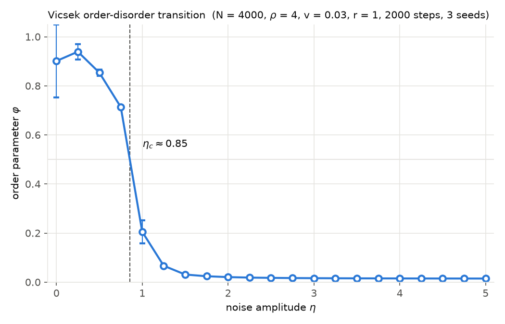

# PyVicsek

[](https://github.com/mehtan-rahman/PyVicsek/actions/workflows/ci.yml)
[](https://codecov.io/gh/mehtan-rahman/PyVicsek)
[](https://pypi.org/project/pyvicsek/)

A small Python library for simulating the [Vicsek model](https://doi.org/10.1103/PhysRevLett.75.1226) of collective motion: self-propelled particles that align with the mean heading of their neighbours within a radius, subject to noise.

What it does:

- Periodic boundary conditions (default, `use_pbc=True`). With `use_pbc=False` the box is open: particles are not wrapped, and a particle that leaves `[0, L)` is simply excluded from neighbour searches. There are no reflecting walls.
- Any number of spatial dimensions (the examples below are 2-D and 3-D; animation is 2-D only).
- Heterogeneous particle types with per-pair alignment and noise weights (`HeterogeneousVicsek`).
- A cell list for neighbour finding, an order-parameter time series, an equilibration check, and a noise sweep (`simulate_phase_transition`).

Noise is applied as a random vector of length `noise_factor` added to the unit mean direction, then renormalised (vectorial noise, as in Gregoire and Chate 2004), not as the uniform angular noise of the 1995 paper. Updates are synchronous: every new heading is computed from the state at time t, then all are applied together. Models accept `seed=` (an int or a numpy Generator) for reproducible runs.

## Installation

```
pip install pyvicsek
```

The import name is `vicsek`. Requires Python 3.10+ and depends on numpy, matplotlib and tqdm. For development:

```
git clone https://github.com/mehtan-rahman/PyVicsek
cd PyVicsek
pip install -e ".[dev]"
```

## Examples

A 2-D system at number density 4:

```python
import vicsek as vs

N, L, v = 400, 10.0, 0.03          # density rho = N / L^2 = 4

particles = vs.initialize_random_particles(
    n_particles=N, box_length=L, speed=v, n_dimensions=2, seed=0
)
model = vs.Vicsek(
    particles=particles, length=L, interaction_range=1.0, speed=v, noise_factor=0.5
)
model.run(200)                      # 200 time steps with a progress bar
print(f"order parameter: {model.order_parameter():.3f}")
```

A 3-D system, stepped by hand:

```python
import vicsek as vs

N, L, v = 500, 5.0, 0.03           # density rho = N / L^3 = 4

particles = vs.initialize_random_particles(
    n_particles=N, box_length=L, speed=v, n_dimensions=3, seed=0
)
model = vs.Vicsek(
    particles=particles, length=L, interaction_range=1.0, speed=v, noise_factor=0.5
)
for _ in range(100):
    model.step()
print(f"order parameter: {model.order_parameter():.3f}")
```

Two particle types that align within a type and anti-align across types:

```python
import vicsek as vs

L, v = 10.0, 0.03
particles = (
    vs.initialize_random_particles(200, L, v, n_dimensions=2, particle_type="A", seed=0)
    + vs.initialize_random_particles(200, L, v, n_dimensions=2, particle_type="B", seed=1)
)
model = vs.HeterogeneousVicsek(
    particles=particles, length=L, interaction_range=1.0, speed=v, base_noise=0.5,
    alignment_weights={("A", "A"): 1.0, ("B", "B"): 1.0, ("A", "B"): -1.0, ("B", "A"): -1.0},
    noise_weights={("A", "A"): 1.0, ("B", "B"): 1.0, ("A", "B"): 2.0, ("B", "A"): 2.0},
)
for _ in range(100):
    model.step()
print(model.get_type_specific_order())   # order parameter per type
```

To animate a 2-D run, `model.animate(frames=200).save("example.gif")`:


More scripts are in `scripts/`, organised by system type.

## Validation

`scripts/validate_phase_transition.py` sweeps the noise amplitude from 0 to 5 at density 4, speed 0.03 and interaction radius 1, averages the order parameter phi = |sum v_i| / (N v) over the second half of each run and over 3 seeds, and estimates the critical noise as the phi = 0.5 crossing.


Quick mode (N = 400, 300 steps per run, 21 noise values, 3 seeds; 152 s on an Apple Silicon M5, Python 3.12, 2026-10-09) gives **eta_c = 1.01**. The order-disorder transition is reproduced, with phi falling to the 1/sqrt(N) = 0.05 noise floor on the disordered side. The value is lower than the 2 to 3 reported by Vicsek et al. for the same N, density and speed because this library uses vectorial rather than angular noise: here `noise_factor = 1` adds a random vector as long as the mean direction itself, so the two noise scales are not directly comparable. Full mode (`--full`: N = 4000, 2000 steps per run, same noise grid and seeds; 181 s on the same machine with the vectorised step) gives **eta_c = 0.85**, with the disordered-side floor at 1/sqrt(N) = 0.016. The downward shift from N = 400 to N = 4000 is the expected finite-size effect: the transition sharpens and moves to lower noise as N grows.



## Performance

`Vicsek.step()` is array arithmetic on the model's `(N, dim)` position and velocity arrays: a vectorised cell list (`CellList.neighbor_pairs`: hash particles to cells, sort, expand each particle's 3^dim neighbouring cells into candidate pairs with `np.repeat`, keep the pairs within range) followed by `bincount` heading sums, one `normal(size=(N, dim))` noise draw, and the position update. There is no Python loop over particles; cost is O(N), about 1.3 microseconds per particle in 2-D at density 4 and 3.3 in 3-D.

`benchmarks/bench_cell_list.py` compares three neighbour searches at fixed density 4 in 2-D, after checking that all three return identical neighbour sets at N = 1000: a brute-force O(N^2) search (one vectorised numpy pass per particle, periodic minimum-image distances), the per-particle API `CellList.get_neighbors` called for every particle, and the vectorised `CellList.neighbor_pairs` (every pair at once, which is what `step()` uses). The speedup column is brute force over `neighbor_pairs`. The last column is a full `Vicsek.step()` (median of 5).

Apple Silicon M5, Python 3.12, numpy 2.5, 2026-10-10, with the vectorised step (this version):

| N | L | brute force (s) | cell list, get_neighbors (s) | cell list, neighbor_pairs (s) | speedup | Vicsek.step() (ms) |
|---:|---:|---:|---:|---:|---:|---:|
| 500 | 11.2 | 0.006 | 0.068 | 0.0003 | 19x | - |
| 1000 | 15.8 | 0.026 | 0.135 | 0.0007 | 37x | - |
| 2000 | 22.4 | 0.076 | 0.242 | 0.0019 | 40x | - |
| 5000 | 35.4 | 0.404 | 0.630 | 0.0039 | 104x | - |
| 10000 | 50.0 | 1.498 | 1.253 | 0.0073 | 205x | 10.7 |
| 20000 | 70.7 | 5.889 | 2.930 | 0.0181 | 326x | 20.7 |

For comparison, the 0.2.0 step (a Python loop over particles calling `get_neighbors`) measured on the same machine a few minutes earlier, median of 5: 176 ms at N = 1000, 820 ms at N = 5000, 3238 ms at N = 20000 in 2-D, and 2612 ms at N = 5000 in 3-D. The vectorised step takes 1.2, 6.2, 26.0 and 16.7 ms respectively, 125-155x faster. `docs/profiling.md` has the phase-by-phase profile before and after.

```
python benchmarks/bench_cell_list.py            # full table
python benchmarks/bench_cell_list.py --quick    # N = 500, 1000, 2000
python benchmarks/bench_cell_list.py --sizes 1000,4000 --step-sizes 4000
python benchmarks/profile_step.py --quick       # per-phase profile of step()
```

## Testing

```
pip install -e ".[dev]"
pytest --cov=vicsek
```

CI runs the suite on Python 3.10, 3.11 and 3.12 and uploads coverage to Codecov.

## Roadmap

- Lyapunov analysis of phase dimensions (based on [this paper](https://doi.org/10.1103/PhysRevE.105.014213)).
- Geometry support for particles and boundaries using [shapely](https://github.com/shapely/shapely).
